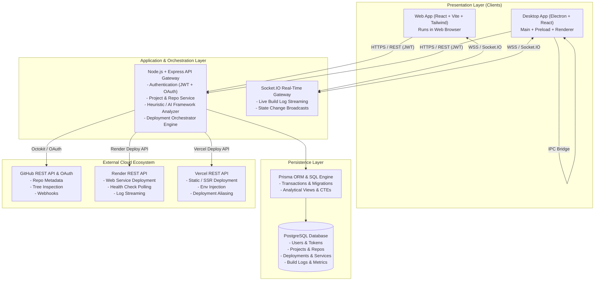
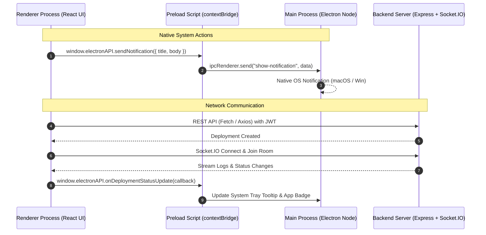
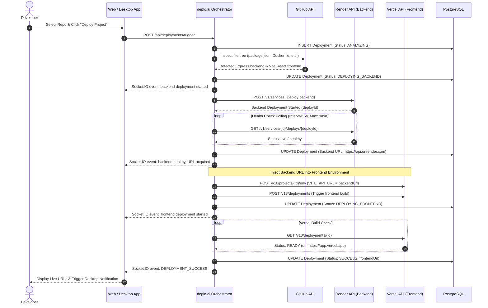
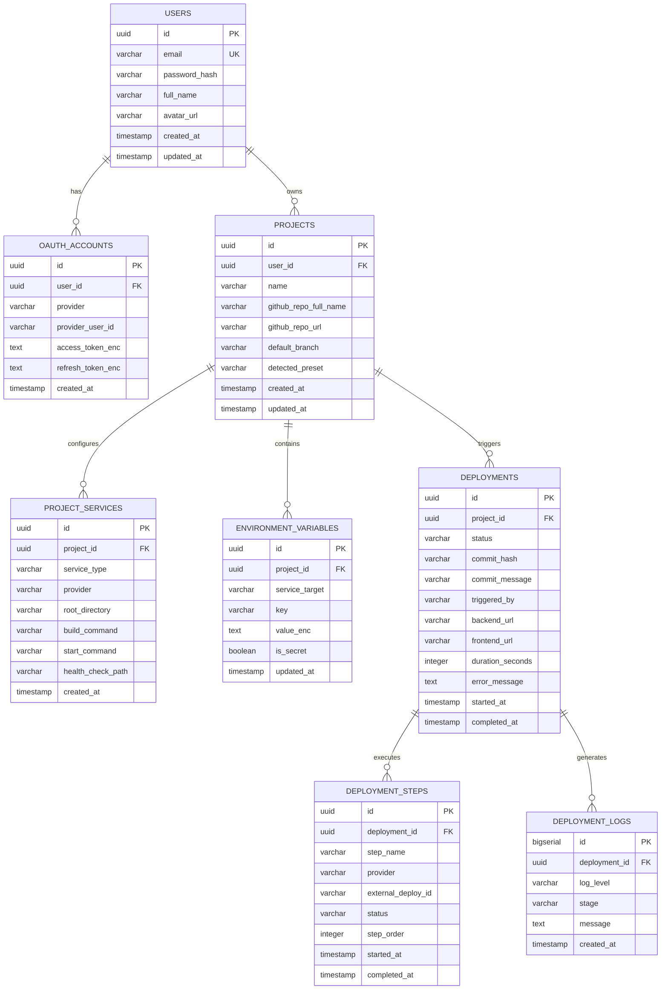

# deplo.ai — System Architecture & Technical Specification

> **Project Title:** deplo.ai — AI-Assisted Deployment & Cloud Orchestration Platform  
> **Course:** Major Project (Web Development, SQL Database, Interactive System Development)  
> **Target Audience:** College Evaluation Committee & Developers  

---

## 1. High-Level System Architecture

`deplo.ai` is designed as a unified, decoupled micro-monorepo. Two client interfaces (**Web Application** and **Electron Desktop Application**) interact with a centralized **Node.js/Express Orchestration Engine**, backed by a relational **PostgreSQL** database and third-party cloud APIs (GitHub, Render, Vercel).



---

## 2. Communication Protocols & Data Flow

### 2.1 Client-to-Backend Communication
Both the Web App and the Desktop App connect to the exact same backend endpoints to ensure feature parity and data consistency.

1. **Synchronous Requests (REST APIs / HTTPS):**
   - **Authentication:** Exchange GitHub OAuth callback codes or email/password credentials for signed JSON Web Tokens (JWT).
   - **Project Management:** Create, configure, inspect, and update projects.
   - **Repository Analysis:** Trigger repository tree scans and framework detection heuristics.
   - **Deployment Triggers:** Initiate and abort deployments.

2. **Asynchronous Real-Time Streams (Socket.IO over WebSockets):**
   - **Room-Based Isolation:** When viewing a deployment, clients join a dedicated room: `socket.emit("join_deployment", { deploymentId })`.
   - **Live Log Streaming:** The orchestrator buffers and broadcasts stdout/stderr log chunks: `socket.to(deploymentId).emit("deployment_log", logChunk)`.
   - **State Transitions:** As deployment moves from `ANALYZING` $\rightarrow$ `DEPLOYING_BACKEND` $\rightarrow$ `HEALTH_CHECKING` $\rightarrow$ `DEPLOYING_FRONTEND` $\rightarrow$ `SUCCESS`, status events are dispatched immediately without client polling.

### 2.2 Electron Desktop Internal Architecture (IPC Flow)
The Desktop Application strictly follows Electron security best practices using the **Context Isolation** and **Preload Script** pattern:



- **Main Process (`main.js`):** Controls window lifecycle, native application menus, dock/taskbar badges, system tray, and native OS notifications.
- **Preload Script (`preload.js`):** Safely exposes a limited set of IPC methods via `contextBridge.exposeInMainWorld('electronAPI', {...})`. Node integration is explicitly disabled in the renderer.
- **Renderer Process (`renderer/`):** React-based UI displaying dashboards, repository lists, configuration editors, and real-time terminal views.

### 2.3 Deployment Orchestration Flow
The sequence below illustrates the automated chaining of backend-first deployment, health verification, and frontend environment injection:



---

## 3. Database Design & PostgreSQL Schema

To satisfy and showcase the **SQL Database** curriculum requirements (Foreign keys, Indexes, Aggregations, Window Functions, Views, Transactions, and CTEs), the schema is fully relational and normalized.

### 3.1 Entity-Relationship Diagram (ERD)



### 3.2 SQL DDL Schema (`schema.sql`)

```sql
-- Enable UUID extension
CREATE EXTENSION IF NOT EXISTS "uuid-ossp";

-- 1. Users Table
CREATE TABLE users (
    id UUID PRIMARY KEY DEFAULT uuid_generate_v4(),
    email VARCHAR(255) UNIQUE NOT NULL,
    password_hash VARCHAR(255),
    full_name VARCHAR(100) NOT NULL,
    avatar_url TEXT,
    created_at TIMESTAMP WITH TIME ZONE DEFAULT CURRENT_TIMESTAMP,
    updated_at TIMESTAMP WITH TIME ZONE DEFAULT CURRENT_TIMESTAMP
);

-- 2. OAuth Accounts (GitHub connection)
CREATE TABLE oauth_accounts (
    id UUID PRIMARY KEY DEFAULT uuid_generate_v4(),
    user_id UUID NOT NULL REFERENCES users(id) ON DELETE CASCADE,
    provider VARCHAR(50) NOT NULL,
    provider_user_id VARCHAR(100) NOT NULL,
    access_token_enc TEXT NOT NULL,
    refresh_token_enc TEXT,
    created_at TIMESTAMP WITH TIME ZONE DEFAULT CURRENT_TIMESTAMP,
    UNIQUE(provider, provider_user_id)
);

-- 3. Projects Table
CREATE TABLE projects (
    id UUID PRIMARY KEY DEFAULT uuid_generate_v4(),
    user_id UUID NOT NULL REFERENCES users(id) ON DELETE CASCADE,
    name VARCHAR(100) NOT NULL,
    github_repo_full_name VARCHAR(255) NOT NULL,
    github_repo_url TEXT NOT NULL,
    default_branch VARCHAR(50) DEFAULT 'main',
    detected_preset VARCHAR(50),
    created_at TIMESTAMP WITH TIME ZONE DEFAULT CURRENT_TIMESTAMP,
    updated_at TIMESTAMP WITH TIME ZONE DEFAULT CURRENT_TIMESTAMP
);

-- 4. Project Services (Frontend / Backend specs)
CREATE TABLE project_services (
    id UUID PRIMARY KEY DEFAULT uuid_generate_v4(),
    project_id UUID NOT NULL REFERENCES projects(id) ON DELETE CASCADE,
    service_type VARCHAR(20) NOT NULL CHECK (service_type IN ('BACKEND', 'FRONTEND')),
    provider VARCHAR(30) NOT NULL CHECK (provider IN ('RENDER', 'VERCEL')),
    root_directory VARCHAR(255) DEFAULT '/',
    build_command VARCHAR(255),
    start_command VARCHAR(255),
    health_check_path VARCHAR(255) DEFAULT '/health',
    created_at TIMESTAMP WITH TIME ZONE DEFAULT CURRENT_TIMESTAMP,
    UNIQUE(project_id, service_type)
);

-- 5. Environment Variables
CREATE TABLE environment_variables (
    id UUID PRIMARY KEY DEFAULT uuid_generate_v4(),
    project_id UUID NOT NULL REFERENCES projects(id) ON DELETE CASCADE,
    service_target VARCHAR(20) NOT NULL CHECK (service_target IN ('BACKEND', 'FRONTEND', 'SHARED')),
    key VARCHAR(100) NOT NULL,
    value_enc TEXT NOT NULL,
    is_secret BOOLEAN DEFAULT true,
    updated_at TIMESTAMP WITH TIME ZONE DEFAULT CURRENT_TIMESTAMP,
    UNIQUE(project_id, service_target, key)
);

-- 6. Deployments Table
CREATE TABLE deployments (
    id UUID PRIMARY KEY DEFAULT uuid_generate_v4(),
    project_id UUID NOT NULL REFERENCES projects(id) ON DELETE CASCADE,
    status VARCHAR(30) NOT NULL DEFAULT 'QUEUED' 
        CHECK (status IN ('QUEUED', 'ANALYZING', 'DEPLOYING_BACKEND', 'HEALTH_CHECKING', 'DEPLOYING_FRONTEND', 'SUCCESS', 'FAILED', 'CANCELLED')),
    commit_hash VARCHAR(40),
    commit_message TEXT,
    triggered_by VARCHAR(50) DEFAULT 'MANUAL',
    backend_url TEXT,
    frontend_url TEXT,
    duration_seconds INTEGER,
    error_message TEXT,
    started_at TIMESTAMP WITH TIME ZONE DEFAULT CURRENT_TIMESTAMP,
    completed_at TIMESTAMP WITH TIME ZONE
);

-- 7. Deployment Execution Steps
CREATE TABLE deployment_steps (
    id UUID PRIMARY KEY DEFAULT uuid_generate_v4(),
    deployment_id UUID NOT NULL REFERENCES deployments(id) ON DELETE CASCADE,
    step_name VARCHAR(100) NOT NULL,
    provider VARCHAR(30),
    external_deploy_id VARCHAR(255),
    status VARCHAR(30) NOT NULL DEFAULT 'PENDING'
        CHECK (status IN ('PENDING', 'RUNNING', 'SUCCESS', 'FAILED', 'SKIPPED')),
    step_order INTEGER NOT NULL,
    started_at TIMESTAMP WITH TIME ZONE,
    completed_at TIMESTAMP WITH TIME ZONE
);

-- 8. Deployment Logs
CREATE TABLE deployment_logs (
    id BIGSERIAL PRIMARY KEY,
    deployment_id UUID NOT NULL REFERENCES deployments(id) ON DELETE CASCADE,
    log_level VARCHAR(10) DEFAULT 'INFO' CHECK (log_level IN ('DEBUG', 'INFO', 'WARN', 'ERROR')),
    stage VARCHAR(50) NOT NULL,
    message TEXT NOT NULL,
    created_at TIMESTAMP WITH TIME ZONE DEFAULT CURRENT_TIMESTAMP
);

-- Performance Indexes
CREATE INDEX idx_projects_user_id ON projects(user_id);
CREATE INDEX idx_deployments_project_id ON deployments(project_id);
CREATE INDEX idx_deployments_status ON deployments(status);
CREATE INDEX idx_deployment_logs_dep_id ON deployment_logs(deployment_id);
CREATE INDEX idx_deployment_steps_dep_id ON deployment_steps(deployment_id);
```

### 3.3 Advanced SQL Concepts Implemented for Evaluation

#### A. Database View with Window Functions & Aggregation
```sql
CREATE OR REPLACE VIEW v_project_deployment_metrics AS
WITH deployment_durations AS (
    SELECT 
        d.id,
        d.project_id,
        d.status,
        d.started_at,
        EXTRACT(EPOCH FROM (d.completed_at - d.started_at))::INT AS calculated_duration,
        ROW_NUMBER() OVER (PARTITION BY d.project_id ORDER BY d.started_at DESC) as recency_rank,
        AVG(EXTRACT(EPOCH FROM (d.completed_at - d.started_at))) OVER (
            PARTITION BY d.project_id 
            ORDER BY d.started_at 
            ROWS BETWEEN 4 PRECEDING AND CURRENT ROW
        ) as moving_avg_duration_5
    FROM deployments d
    WHERE d.completed_at IS NOT NULL
)
SELECT 
    p.id AS project_id,
    p.name AS project_name,
    COUNT(d.id) AS total_deployments,
    COUNT(CASE WHEN d.status = 'SUCCESS' THEN 1 END) AS successful_deployments,
    COUNT(CASE WHEN d.status = 'FAILED' THEN 1 END) AS failed_deployments,
    ROUND(
        (COUNT(CASE WHEN d.status = 'SUCCESS' THEN 1 END)::NUMERIC / NULLIF(COUNT(d.id), 0)) * 100, 
        2
    ) AS success_rate_percentage,
    ROUND(AVG(dd.calculated_duration), 1) AS avg_duration_seconds,
    MAX(d.started_at) AS last_deployment_date
FROM projects p
LEFT JOIN deployments d ON p.id = d.project_id
LEFT JOIN deployment_durations dd ON d.id = dd.id
GROUP BY p.id, p.name;
```

#### B. SQL Transaction for Atomic Deployment Initialization
```sql
-- Atomic operation executed when a deployment is requested:
BEGIN;
  -- 1. Insert Deployment Master Record
  INSERT INTO deployments (id, project_id, status, commit_hash, commit_message, triggered_by)
  VALUES ('d0000000-0000-0000-0000-000000000001', 'p0000000-0000-0000-0000-000000000001', 'ANALYZING', 'a1b2c3d', 'feat: update api', 'MANUAL');

  -- 2. Insert Execution Steps in Sequence
  INSERT INTO deployment_steps (deployment_id, step_name, provider, step_order, status)
  VALUES 
    ('d0000000-0000-0000-0000-000000000001', 'Repository Inspection', 'GITHUB', 1, 'RUNNING'),
    ('d0000000-0000-0000-0000-000000000001', 'Backend Build & Deploy', 'RENDER', 2, 'PENDING'),
    ('d0000000-0000-0000-0000-000000000001', 'Backend Health Verification', 'RENDER', 3, 'PENDING'),
    ('d0000000-0000-0000-0000-000000000001', 'Environment Injection', 'VERCEL', 4, 'PENDING'),
    ('d0000000-0000-0000-0000-000000000001', 'Frontend Build & Deploy', 'VERCEL', 5, 'PENDING');

  -- 3. Initial Log Entry
  INSERT INTO deployment_logs (deployment_id, log_level, stage, message)
  VALUES ('d0000000-0000-0000-0000-000000000001', 'INFO', 'ORCHESTRATOR', 'Deployment orchestration pipeline initialized.');
COMMIT;
```

---

## 4. Complete Project Directory Structure

```
deplo.ai/
├── package.json                   # Monorepo root scripts (npm workspaces or turbo)
├── README.md                      # High-level overview & setup instructions
├── .gitignore                     # Monorepo ignore rules
├── .env.example                   # Master template for environment variables
├── apps/
│   ├── web/                       # React Web Application
│   │   ├── index.html
│   │   ├── package.json
│   │   ├── vite.config.js
│   │   ├── tailwind.config.js
│   │   ├── postcss.config.js
│   │   └── src/
│   │       ├── main.jsx
│   │       ├── App.jsx
│   │       ├── index.css
│   │       ├── api/               # Axios REST API client
│   │       ├── components/        # UI components (Navbar, Modals, Terminal, StatusBadge)
│   │       ├── context/           # AuthContext, SocketContext
│   │       ├── hooks/             # useDeployment, useLogs, useAuth
│   │       ├── pages/             # Dashboard, ProjectDetail, NewProject, DeployHistory
│   │       └── utils/             # Formatters, constants
│   │
│   └── desktop/                   # Electron Desktop Application
│       ├── package.json
│       ├── electron/
│       │   ├── main.js            # Main process: Window management, Tray, IPC handlers
│       │   ├── preload.js         # Context isolation bridge exposing electronAPI
│       │   └── assets/            # App icons, tray icons (.png, .icns)
│       ├── vite.config.js
│       └── src/                   # Renderer UI (React)
│           ├── main.jsx
│           ├── App.jsx
│           ├── components/        # Desktop-specific components (LogViewer, QuickSwitcher)
│           └── hooks/             # useNativeNotifications, useIpcBridge
│
├── server/                        # Express.js Shared Backend
│   ├── package.json
│   ├── .env.example
│   └── src/
│       ├── server.js              # HTTP & Socket.IO server bootstrap
│       ├── config/                # Environment, DB, Octokit, Render, Vercel configs
│       ├── controllers/           # Route handler logic (auth, project, deployment, analytics)
│       ├── middleware/            # JWT auth, error handler, request validator
│       ├── routes/                # Express router definitions (/api/v1/...)
│       ├── services/              # Core business logic:
│       │   ├── github.service.js  # Octokit repository tree scanner & analyzer
│       │   ├── analyzer.service.js# Framework heuristic detector (Vite, Next, Express, etc.)
│       │   ├── render.service.js  # Render API client (create service, poll deploy, health check)
│       │   ├── vercel.service.js  # Vercel API client (set env, create deploy)
│       │   └── orchestrator.js    # Finite state machine managing the pipeline
│       ├── sockets/               # Socket.IO room manager & log stream dispatcher
│       └── utils/                 # Encryption (AES-256 for tokens), logger, sleep helpers
│
├── database/                      # PostgreSQL & Prisma ORM
│   ├── schema.prisma              # Prisma Schema definition
│   ├── schema.sql                 # Pure SQL DDL for database creation
│   ├── migrations/                # Prisma database migration history
│   ├── seed.sql                   # Sample test users, projects, and deployments
│   └── queries/                   # College-level SQL queries (CTEs, Views, Aggregates)
│
├── shared/                        # Shared Types, Constants & Config
│   ├── package.json
│   └── src/
│       ├── constants.js           # Deployment statuses, provider types, event names
│       └── contracts.js           # API request/response schemas
│
└── docs/                          # College Project Documentation
    ├── architecture.md            # Architectural diagrams and design decisions
    ├── database_design.md         # Schema rationale, relational design, normalization
    ├── api_specification.md       # OpenAPI / Swagger-style endpoint definitions
    └── viva_questions_guide.md    # Answers to probable viva and evaluation questions
```

---

## 5. Technology Stack & Rationale

| Layer / Component | Technology Selected | Concrete Rationale & Free-Tier Suitability |
| :--- | :--- | :--- |
| **Frontend Web** | React 18 + Vite + Tailwind CSS | Fast HMR, lightweight bundle, responsive layout for responsive cloud dashboard. |
| **Desktop App** | Electron.js + Preload Bridge | Enables native OS notifications, system tray monitoring, and background log listening while reusing React components. |
| **Backend API** | Node.js + Express.js | Event-driven, asynchronous I/O ideal for polling external APIs and streaming deployment logs. |
| **Real-Time Stream**| Socket.IO | WebSockets with automatic fallback, room-based multicasting for live build log streaming to both web and desktop. |
| **Primary Database**| PostgreSQL 15+ | Industrial standard for relational data, ACID compliance for financial/deployment transactions, rich SQL capabilities (CTEs, Window functions). Free via local Postgres or Neon.tech / Supabase free tiers. |
| **ORM & SQL Tooling**| Prisma ORM + Raw SQL | Prisma gives type-safe access and migrations, while raw SQL views satisfy university requirements for complex queries. |
| **Version Control** | GitHub REST API (Octokit) | Programmatic repository tree inspection, branch querying, and OAuth authentication without cloning entire repos. |
| **Backend Deploy** | Render REST API | Free tier web services with public HTTPS URLs, programmatic deployment creation, and direct health check verification. |
| **Frontend Deploy** | Vercel REST API | Industry gold standard for deploying static/Vite frontends with instant previews and programmatic environment variable assignment. |

---

## 6. 12-Phase Development Roadmap

```mermaid
flowchart LR
    P1["P1: Architecture\n& Schema"] --> P2["P2: Monorepo\nSetup"]
    P2 --> P3["P3: Database\n& Express"]
    P3 --> P4["P4: Auth &\nGitHub OAuth"]
    P4 --> P5["P5: React\nWeb App"]
    P5 --> P6["P6: Electron\nDesktop App"]
    P6 --> P7["P7: Repo\nAnalyzer"]
    P7 --> P8["P8: Deployment\nConfig"]
    P8 --> P9["P9: Cloud APIs\n(Render/Vercel)"]
    P9 --> P10["P10: Orchestration\nEngine"]
    P10 --> P11["P11: Real-Time\nLogs & Analytics"]
    P11 --> P12["P12: Testing\n& Presentation"]
```



- **Phase 1: Requirements, Architecture & Database Design** *(Current Milestone)*: Establish technical architecture, schemas, IPC protocols, and roadmap.
- **Phase 2: Project Setup & Workspace Initialization**: Configure npm workspaces monorepo, environment configurations, and base scripts.
- **Phase 3: PostgreSQL Database & Express Backend Foundation**: Connect Prisma to local/remote PostgreSQL, run initial migrations, and build base Express server with health routes.
- **Phase 4: Authentication & User Management**: Implement JWT authentication, GitHub OAuth token exchange, and credential encryption.
- **Phase 5: React Web Application**: Build modern dashboard layout, project management UI, and deployment status displays.
- **Phase 6: Electron Desktop Application**: Implement Electron main process, secure preload bridge, native notifications, and tray integration.
- **Phase 7: GitHub Integration & Repository Analysis Engine**: Implement Octokit tree traversal and heuristic rule engine to detect frontend (`package.json`, Vite, React) and backend (`server.js`, Express, Python).
- **Phase 8: Deployment Configuration & Environment Variables**: Allow developers to customize ports, build/start commands, and securely store environment variables.
- **Phase 9: Cloud Provider Integrations (Render & Vercel)**: Build isolated API adapters for Render (create web service, poll deploy) and Vercel (create deployment, set env).
- **Phase 10: Automated Deployment Orchestrator**: Build the state machine coordinating: Backend Deploy $\rightarrow$ Health Check $\rightarrow$ Auto-inject URL into Frontend Env $\rightarrow$ Frontend Deploy.
- **Phase 11: Real-Time Log Streaming & Analytics Dashboard**: Implement Socket.IO live terminal viewer on web/desktop, plus SQL views for success rate and average deployment durations.
- **Phase 12: End-to-End Testing, Security Hardening, & Presentation Preparation**: Comprehensive test suite, error recovery validation, demo repositories, and viva preparation guide.
