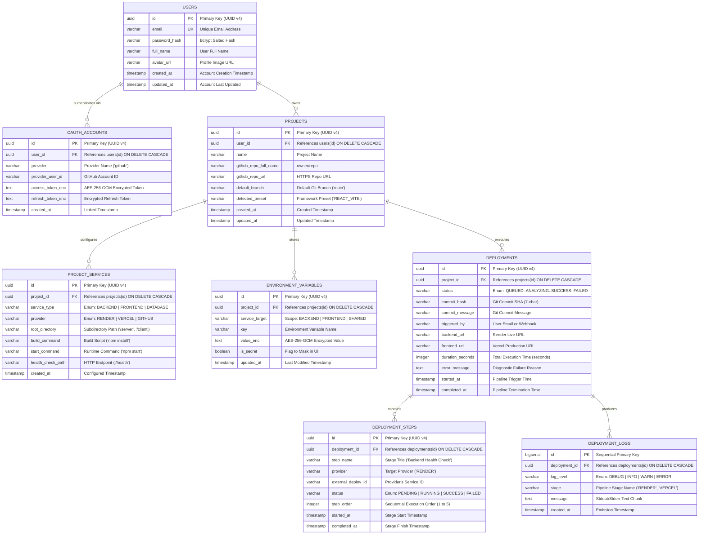

# deplo.ai — Database Design & Relational Schema Specification

> **Course Requirement:** SQL Database (Relational Design, Normalization, Integrity Constraints, Advanced Queries)  
> **Database Engine:** PostgreSQL 15+ / PostgreSQL 18  
> **ORM & Tooling:** Prisma ORM, Raw SQL DDL, SQL Views  

---

## 1. Relational Entity-Relationship Diagram (ERD)

---

## 2. Normalization Analysis (1NF $\rightarrow$ 2NF $\rightarrow$ 3NF)

### First Normal Form (1NF)
- **Requirement:** Each column contains only atomic (indivisible) values, and each record is unique.
- **Implementation:**
  - Multiple services (frontend and backend) are not stored as comma-separated strings inside `projects`. Instead, they are decoupled into the normalized `project_services` table.
  - Environment variables are broken down into individual atomic rows in `environment_variables`.
  - Every table has a designated primary key (`id UUID PRIMARY KEY`).

### Second Normal Form (2NF)
- **Requirement:** The table must be in 1NF, and all non-key attributes must be fully functionally dependent on the entire primary key (no partial dependencies).
- **Implementation:**
  - All entity tables use surrogate UUID primary keys (`id`).
  - Attributes such as `build_command`, `root_directory`, and `start_command` depend solely on `project_services.id`, not on `projects.id`.
  - Log records depend solely on `deployment_logs.id` and are mapped to `deployments.id`.

### Third Normal Form (3NF)
- **Requirement:** The table must be in 2NF, and no non-key attribute may depend transitively on the primary key (no transitive dependencies: $X \rightarrow Y \rightarrow Z$).
- **Implementation:**
  - User profile attributes (`email`, `full_name`) are kept in `users`, and only `user_id` is referenced in `projects` and `oauth_accounts`.
  - Deployment step execution states (`status`, `step_order`) are isolated in `deployment_steps` rather than stored in a denormalized array inside `deployments`.

---

## 3. Data Dictionary & Integrity Constraints

| Table Name | Column Name | Data Type | Constraints | Description |
| :--- | :--- | :--- | :--- | :--- |
| **users** | `id` | `UUID` | `PRIMARY KEY` | Unique user identifier generated via `uuid_generate_v4()`. |
| | `email` | `VARCHAR(255)` | `UNIQUE, NOT NULL` | Login email address. |
| | `password_hash`| `VARCHAR(255)` | `NULLABLE` | Bcrypt hashed password (null for pure OAuth users). |
| | `full_name` | `VARCHAR(100)` | `NOT NULL` | Developer's display name. |
| **projects** | `id` | `UUID` | `PRIMARY KEY` | Project identifier. |
| | `user_id` | `UUID` | `FOREIGN KEY, NOT NULL` | References `users(id) ON DELETE CASCADE`. |
| | `name` | `VARCHAR(100)` | `NOT NULL` | Human-readable project name. |
| | `github_repo_url`| `TEXT` | `NOT NULL` | Full HTTPS URL to GitHub repository. |
| **project_services**| `project_id` | `UUID` | `FOREIGN KEY, NOT NULL` | References `projects(id) ON DELETE CASCADE`. |
| | `service_type` | `ENUM` | `CHECK (IN ('BACKEND', 'FRONTEND', 'DATABASE'))` | Component role. |
| | `provider` | `ENUM` | `CHECK (IN ('RENDER', 'VERCEL', 'GITHUB'))` | Deployment cloud target. |
| **environment_variables** | `value_enc` | `TEXT` | `NOT NULL` | Symmetric ciphertext encrypted with AES-256-GCM. |
| | `is_secret` | `BOOLEAN` | `DEFAULT true` | Controls whether value is masked with bullets in UI. |
| **deployments** | `status` | `ENUM` | `NOT NULL` | State machine enum (`QUEUED`, `ANALYZING`, etc.). |
| | `duration_seconds`| `INTEGER` | `NULLABLE` | Total runtime in seconds. |

---

## 4. Indexing Strategy & Performance Justification

To maintain sub-10ms query performance at scale:

1. **`idx_projects_user_id` ON `projects(user_id)`:**
   - **Reason:** Every dashboard request filters by `WHERE user_id = $1`. Without an index, PostgreSQL executes an expensive Sequential Scan ($O(n)$). With B-Tree indexing, retrieval takes $O(\log n)$.
2. **`idx_deployments_project_id` ON `deployments(project_id)`:**
   - **Reason:** Speeds up historical deployment queries and foreign key join checks during cascading deletes.
3. **`idx_deployments_status` ON `deployments(status)`:**
   - **Reason:** Filters queued or active deployments during polling and metrics computation.
4. **`idx_deployment_logs_dep_id` ON `deployment_logs(deployment_id)`:**
   - **Reason:** Build logs can exceed tens of thousands of rows per deployment. An index prevents full-table scans when streaming logs to the terminal.

